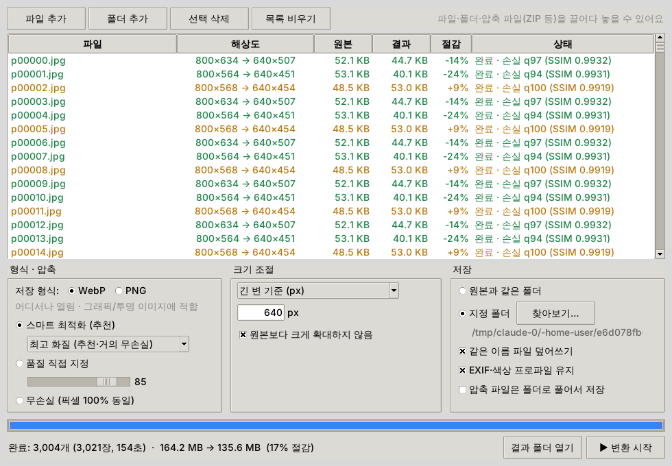

# WebP·PNG 변환기 (Windows / macOS)

여러 이미지를 한 번에 **WebP 또는 PNG**로 변환·축소하는 데스크톱 프로그램입니다.

- **스마트 최적화**: 화질 차이가 거의 없는 선에서 가장 작은 파일을 자동으로 찾아줍니다
- **리사이즈**: 긴 변 / 가로 / 세로 / 비율(%) / 가로×세로 상자 안에 맞춤
- 지원 형식: JPG, PNG, GIF(애니메이션 포함), BMP, TIFF, WebP, HEIC(아이폰)
- 파일·폴더를 창에 끌어다 놓기, 폴더째 추가(하위 폴더 포함), 여러 파일 동시 처리
- 사진 회전(EXIF) 자동 반영, EXIF·색상 프로파일 유지, 투명 배경 유지
- 원본은 건드리지 않으며, 같은 이름의 파일이 있으면 `이름_1.webp` 식으로 저장합니다



## 주의사항

(프로그램 안의 **도움말·주의사항** 버튼(또는 F1 키)에도 같은 내용이 있고, 각 옵션 옆의 파란 **[?]** 버튼을 누르면 그 항목만 따로 설명해 줍니다)

**화질·용량**
- WebP는 손실 압축입니다. '최고 화질'도 픽셀이 100% 같지는 않고, 눈으로 구분하기 어려운 수준입니다. 완전히 같게 저장하려면 '무손실'을 고르세요.
- **이미 변환한 WebP를 다시 변환하지 마세요.** 화질이 한 번 더 나빠집니다. 항상 원본으로 변환하세요.
- JPG처럼 이미 압축된 사진을 **PNG나 WebP 무손실로 바꾸면 용량이 오히려 커집니다.** 용량을 줄이려면 WebP 스마트 최적화를 쓰세요.
- 이미 많이 압축된 JPG를 '최고 화질'로 변환하면 원본보다 커질 수 있습니다(테스트에서 +9%). 이럴 땐 '균형'을 쓰세요. 용량이 늘어난 파일은 목록에 주황색(+%)으로 표시됩니다.
- 노이즈가 많은 사진은 '최고 화질'에서 **q85로 저장되며 화질이 떨어질 수 있습니다**(상태에 안내가 표시되고 주황색). 아래 '알아둘 한계' 참고.
- 사진은 WebP, 스크린샷·로고·투명 이미지는 PNG가 잘 맞습니다.

**개인정보**
- 'EXIF·색상 프로파일 유지'를 켜면 **촬영 위치(GPS)와 카메라 정보가 결과 파일에도 남습니다.** 인터넷에 올리거나 남에게 보낼 사진은 끄세요.
- 사진의 회전 정보는 항상 반영해서 저장합니다. 16비트 흑백·CMYK 이미지는 일반 색상(RGB)으로 바뀝니다.

**압축 파일**
- **RAR/CBR은 지원하지 않습니다.** 넣으면 건너뛰었다는 안내가 뜹니다. ZIP으로 바꿔서 넣어주세요.
- 암호가 걸린 압축 파일, 손상된 압축 파일은 오류로 표시됩니다.
- 처리 중 임시로 압축을 풉니다. 한 번에 2개까지 풀기 때문에 시스템 드라이브에 그만한 여유 공간이 필요하고, 끝나면 자동으로 지웁니다. (프로그램이 강제 종료돼서 남은 임시 폴더는 다음 실행 때 정리)
- 압축 안에 같은 이름의 이미지(`01.jpg`, `01.png`)가 있으면 `01_1.webp`처럼 번호가 붙습니다.

**저장·작업**
- 원본은 수정하거나 삭제하지 않습니다. 같은 이름이 있으면 `이름_1.webp`로 저장하고, '덮어쓰기'를 켜면 기존 파일을 **복구할 수 없게** 덮어씁니다.
- 위험한 설정(용량 증가 가능성, 덮어쓰기, GPS 남김, 압축 풀기)으로 시작하면 **확인창**이 먼저 뜹니다.
- 변환 중에는 목록을 바꿀 수 없고, 창을 닫으면 작업이 중단됩니다. 중지해도 이미 끝난 파일은 그대로 남습니다.
- 2,500만 화소가 넘는 큰 사진은 동시에 2장까지만 처리합니다. 메모리가 부족하면 그 파일은 오류로 표시됩니다.
- PNG 저장은 WebP보다 4배쯤 오래 걸립니다.

**호환성**
- WebP는 최신 브라우저·휴대폰·포토샵(2022 이후)에서 열립니다. 오래된 프로그램, 일부 사이트 업로드, 인쇄 서비스는 WebP를 받지 않을 수 있으니 그럴 땐 PNG로 저장하세요.
- WebP는 한 변이 16,383px을 넘을 수 없어 더 큰 이미지는 자동으로 줄입니다.
- 움직이는 PNG는 일부 오래된 뷰어에서 첫 장면만 보일 수 있습니다.
- 이 프로그램은 Windows·macOS 용으로 만들었지만, **개발 환경(리눅스)에서만 실행해 봤고** 실제 Windows·Mac 에서의 동작과 속도는 확인하지 못했습니다. 문제가 있으면 알려주세요.

## 자르기 (일괄 + 개별)

원하는 비율로 자른 뒤 크기를 조절합니다. **원본은 잘리지 않고 결과 파일만 잘립니다.**

**일괄** — '크기 · 자르기'에서 비율을 고르면 모든 사진(압축 파일 안 이미지 포함)에 적용됩니다.

- 비율: 1:1, 4:3, 3:2, 16:9, 4:5(인스타 세로), 2:3, 9:16(세로 영상), 직접 입력(예: 21:9)
- 위치: **가운데** 또는 **자동(피사체)** — 디테일이 많은 쪽을 남깁니다 (얼굴 인식이 아니라 가끔 빗나갈 수 있음)
- **사진 방향에 맞춰 비율 뒤집기**: 가로·세로 사진이 섞여 있을 때 세로 사진에는 16:9 대신 9:16으로 적용
- 예) 16:9 + 긴 변 1280 → 정확히 **1280×720**
- 크기 조절의 **가로×세로 꽉 채우기**: 1280×720 처럼 크기만 입력하면 어떤 사진이든 그 크기로 맞추고 넘치는 부분을 자름

**개별** — 목록에서 사진을 **더블클릭**(또는 [✂ 개별 자르기])하면 미리보기 창이 열립니다.

- 박스 안을 끌면 이동, 모서리를 끌면 크기 조절, 박스 밖을 끌면 새로 그리기 (비율 고정 / 자유 선택 가능)
- ←/→ 로 다음 사진 (바꾼 내용은 자동 저장), Enter 적용하고 닫기, Esc 취소
- 지정한 사진은 목록에 **✂** 표시, 개별 지정이 일괄 설정보다 우선
- **일부 사진만 자르려면**: 일괄은 '자르지 않음'으로 두고, 자를 사진만 개별로 지정
- 오른쪽 클릭 메뉴: '이 사진은 자르지 않기', '일괄 설정대로 되돌리기', 결과·원본 파일 위치 열기
- 압축 파일 안의 이미지는 개별로 자를 수 없습니다 (일괄 설정은 적용). 개별 지정은 프로그램을 닫으면 사라집니다.

## 압축 파일(ZIP 등) 일괄 변환

만화·사진 뷰어처럼 **압축 파일을 그대로 넣으면 안의 이미지를 모두 변환**해서 다시 묶어줍니다.

- 지원 형식: **ZIP, CBZ, 7Z, CB7, TAR, TAR.GZ** (RAR/CBR 은 미지원 - 반디집 등으로 ZIP 으로 바꿔서 넣어주세요)
- 결과: `원래이름_webp.zip` (CBZ 는 `.cbz` 로) — 폴더 구조와 순서 그대로, 이미지 외 파일(설명서 등)도 함께 넣음
- "압축 파일은 폴더로 풀어서 저장"을 켜면 `원래이름_webp` 폴더로 저장
- 윈도우에서 만든 ZIP 의 **한글 파일명 깨짐을 자동 복구**
- 손상된 이미지는 건너뛰고 몇 장이 실패했는지 표시, 암호 걸린 압축 파일은 안내 메시지
- 안전: `../` 같은 경로로 압축 바깥에 파일을 쓰는 악성 압축 파일 차단, 맥 전용 찌꺼기 파일(`__MACOSX`) 제외

## 대량 처리

- 수천~수만 개를 넣어도 목록은 백그라운드에서 읽어서 화면이 멈추지 않음 (3,000개 0.4초)
- CPU 코어를 모두 사용하고, 진행 표시줄에 **처리 속도(장/초)와 남은 시간** 표시
- 2,500만 화소 이상 큰 사진은 동시에 2장까지만 열어서 메모리 부족 방지
- 압축 파일은 2개까지만 미리 풀어둬서 디스크를 과하게 쓰지 않음 (변환이 끝난 원본은 바로 삭제)

## 스마트 최적화는 어떻게 동작하나요?

WebP 품질값을 바꿔 가며 인코딩하고 매번 결과를 원본과 비교(밝기 채널 SSIM, 구조적 유사도)해서
**목표 화질을 만족하는 가장 낮은 품질값**을 고릅니다. 사진마다 적정 품질이 달라서
(예: 잔디 사진은 q76이면 충분, 인물 사진은 q90 필요) 고정 품질보다 용량과 화질 모두 유리합니다.

| 단계 | 목표 SSIM | 설명 |
|---|---|---|
| **최고 화질 (기본값)** | 0.993 | 시각적 무손실. 3배 확대해도 차이를 찾기 어려움. 대개 q92~97 |
| 균형 | 0.985 | 100% 크기로는 차이가 거의 없지만 확대하면 약간 뭉개짐. 대개 q76~91 |
| 작은 용량 | 0.975 | 웹 업로드용. 확대하면 약간의 차이 |

- PNG·스크린샷·그래픽 같은 무손실 원본은 **무손실 WebP와도 비교**해서 더 작은 쪽을 선택합니다
  (예: 스크린샷 34KB → 무손실 2.6KB).
- JPG처럼 이미 손실 압축된 원본은 무손실로 저장해도 용량만 커지므로 무손실을 시도하지 않습니다.
- 60만 화소 이상 이미지는 먼저 작은 표본 타일(면적 15~20%)로 품질을 대략 찾고, 그 근처에서 정밀 탐색을 시작합니다
  (결과는 똑같고 4~22% 빠름).
- 품질 탐색은 측정값으로 목표 지점을 보간해서 보통 인코딩 3~4번이면 끝납니다. 탐색 때 만든 결과물 중
  통과한 것을 **그대로 최종 파일로** 쓰기 때문에 따로 최종 인코딩을 하지 않습니다.
- 화질 측정(SSIM)은 7×7 창을 겹치지 않게 놓아 계산합니다. 모든 위치를 재는 방식과 값이 사실상 같으면서
  (평균 차 0.00001 미만) 10배쯤 빠릅니다.
- **큰 이미지(250만 화소 초과)를 줄이지 않고 변환할 때**는 원본 해상도의 작은 타일 100개를 고르게 뽑아
  품질을 찾은 뒤, 전체를 인코딩한 결과를 **이미지 전체에서 다시 측정**합니다. 목표에 못 미치면 품질을 올리고,
  용량이 10% 이상 줄 여지가 있으면 내려서 다시 인코딩합니다.

### 알아둘 한계

- SSIM은 **하늘처럼 매끈한 그라데이션의 미세한 얼룩(블록 무늬)** 을 잘 잡지 못합니다. 그래서 수치가 같아도
  품질을 임의로 더 낮추지 않고, 단계별 최저 품질(최고 화질 q85, 균형 q72, 작은 용량 q60) 아래로는 내려가지 않습니다.
- 노이즈가 많은 사진(고감도·어두운 곳에서 찍은 사진 등)은 q100으로도 '최고 화질' 목표(0.993)에 못 미칠 수 있습니다.
  q100은 용량이 5~10배 커지는 데 비해 화질 이득이 거의 없어서, 이때는 **q85로 저장하고 상태에
  '목표 화질 도달 불가 → 화질이 떨어질 수 있음'을 표시**합니다(목록에서 주황색, 마지막 요약에 개수 표시).
  q85의 실제 화질은 사진에 따라 SSIM 0.91~0.98로 차이가 큽니다. 화질이 중요한 파일은 '무손실'이나 '품질 직접 지정'
  (높은 값)으로 다시 변환하세요. (원본이 PNG면 원본보다 작은 경우 무손실로 저장해 화질을 지킵니다)

테스트 결과 (작은 샘플 8장, 균형 단계): 2.8MB → 459KB (**84% 절감**), 모든 이미지 SSIM 0.985 이상.

## PNG로 저장할 때

화면 왼쪽 아래 **저장 형식**에서 PNG를 고르면 됩니다. 압축 방식은 WebP와 같은 세 가지입니다.

- **무손실**: 픽셀은 그대로 두고 [oxipng](https://github.com/shssoichiro/oxipng)로 최대한 압축합니다
  (256색 이하 그래픽은 자동으로 팔레트 PNG로 바꿈).
- **스마트 최적화**: pngquant와 같은 엔진(libimagequant)으로 색상 수를 256→128→64→32로 줄여 보면서,
  화질 기준(흐리게 한 비교와 그대로 비교, 두 가지 모두)을 통과하는 가장 작은 파일을 고릅니다.
  통과하지 못하면 무손실로 저장합니다.
- **품질 직접 지정**: 색상 줄이기 품질(1~100)을 직접 정합니다.
- 움직이는 GIF는 움직이는 PNG(APNG)로 저장합니다. 모든 프레임이 팔레트 하나를 공유하므로 GIF보다 작게 나옵니다.

**언제 PNG를 쓰나요?** 스크린샷·로고·도표·투명 배경 이미지에 좋습니다
(예: 스크린샷 34KB → 5.3KB, 투명 PNG 502KB → 40KB).
**사진은 WebP를 추천합니다.** 같은 화질이면 PNG가 WebP보다 3~8배 큽니다.
(1280px 사진: WebP 최고화질 120~180KB, PNG 무손실 약 1MB. 색 변화가 많은 사진은 화질을 지키려고 무손실로 저장합니다)

## 다른 압축 방식

- **품질 직접 지정**: 1~100 사이의 고정 품질
- **무손실**: 픽셀이 원본과 100% 동일 (PNG 대체용)

## 실행 방법 (설치 필요 없음, 포터블)

설치 프로그램이 없습니다. **압축을 풀고 실행 파일을 더블클릭**하면 끝이고, 지울 때는 파일만 삭제하면 됩니다.
폴더(또는 USB)째 옮겨서 다른 PC에서 써도 됩니다.

- 설정은 프로그램 바로 옆의 `WebPConverter.settings.json`에 저장됩니다. 윈도우 레지스트리나 사용자 폴더에는 아무것도 남기지 않습니다.
- 프로그램 폴더에 쓸 수 없으면(읽기 전용 USB, `Program Files` 등) 설정이 사용자 폴더에 저장됩니다.
- 압축 파일(ZIP 등)을 처리하는 동안에만 임시 폴더를 쓰고, 끝나면 지웁니다.
- 한글·공백이 든 경로(예: `바탕 화면`)에서도 실행됩니다. 환경에 따라 **끌어다 놓기만 못 쓰게 될 수 있고**,
  그럴 때는 안내 문구가 나오며 [파일 추가]·[폴더 추가] 버튼은 그대로 동작합니다.

### 1) 빌드된 실행 파일 받기 (GitHub Actions)

이 폴더를 GitHub 저장소에 올리고 `v1.0` 같은 태그를 push하면, Actions가 자동으로 아래 파일을 만들어 Releases에 올려줍니다.
(Actions 탭 → Build → Run workflow 로 수동 실행도 가능)

| 파일 | 설명 |
|---|---|
| `WebPConverter-Windows-Setup.exe` | **Windows 설치 파일.** 더블클릭 → 설치 마법사(한국어). 관리자 권한 없이 내 계정에 설치, 시작 메뉴 등록, 바탕 화면 바로가기(선택), 제어판/설정의 '앱'에서 제거 |
| `WebPConverter-Windows-Portable.zip` | Windows 폴더형 (설치 없이 사용). 풀어서 `WebPConverter\WebPConverter.exe` 실행. 시작이 빠르고 백신 오탐이 적음 |
| `WebPConverter-Windows-SingleFile.exe` | Windows 파일 하나. 아무 곳에나 두고 실행. 켤 때마다 임시로 풀어서 시작이 몇 초 느림 |
| `WebPConverter-macOS-AppleSilicon.dmg` | **맥 설치 파일 (M1 이후).** 열어서 `WebPConverter`를 `Applications` 폴더로 끌어다 놓기 |
| `WebPConverter-macOS-Intel.dmg` | 맥 설치 파일 (인텔) |
| `WebPConverter-macOS-AppleSilicon.zip`, `...-Intel.zip` | 맥 포터블. 풀어서 `WebPConverter.app`을 다른 폴더로 옮긴 뒤 실행 |

> 맥은 다운로드한 앱을 압축 폴더 안에서 바로 실행하면 보안 기능 때문에 읽기 전용이 되어 설정이 저장되지 않을 수 있습니다.
> 앱을 다른 폴더로 옮긴 뒤 실행하세요.

### 2) 직접 빌드

**Windows** — [python.org](https://www.python.org/downloads/)에서 Python 3.10+ 설치 후
`build_windows.bat` 더블클릭 → `dist\WebPConverter-Windows-Portable.zip`, `dist\WebPConverter-Windows-SingleFile.exe`
(설치 파일 `dist\WebPConverter-Windows-Setup.exe`는 [Inno Setup 6](https://jrsoftware.org/isinfo.php)이 설치돼 있을 때 같이 만들어집니다.
없으면 `winget install JRSoftware.InnoSetup` 으로 설치한 뒤 다시 실행하세요. 설치 파일 설정은 `installer.iss`)

**macOS** — python.org의 Python 3.10+ 설치 후 터미널에서

```bash
./build_mac.sh
```

→ `dist/WebPConverter-macOS.dmg` (설치용), `dist/WebPConverter-macOS.zip` (포터블)

> 서명되지 않은 앱이라 macOS에서 처음 실행할 때 "확인되지 않은 개발자" 경고가 뜰 수 있습니다.
> 앱을 **우클릭 → 열기**로 한 번 실행하거나, 다음 명령을 실행하세요:

```bash
xattr -cr /앱이/있는/경로/WebPConverter.app
```

> Windows에서는 SmartScreen 경고가 뜨면 **추가 정보 → 실행**을 누르세요.

### 3) 파이썬으로 바로 실행

이 방식은 포터블이 아니라서 설정이 사용자 폴더(`~/.webp_converter.json`)에 저장됩니다.

```bash
pip install -r requirements.txt
```

```bash
python app.py
```

## 파일 구성

| 파일 | 내용 |
|---|---|
| `app.py` | GUI (tkinter) |
| `webp_core.py` | 변환 엔진 (자르기, 리사이즈, 스마트 최적화, 메타데이터 처리) |
| `crop_editor.py` | 개별 자르기 미리보기 창 |
| `build_windows.bat` / `build_mac.sh` | 포터블 실행 파일 빌드 스크립트 (PyInstaller) |
| `installer.iss` | Windows 설치 파일 설정 (Inno Setup) |
| `PORTABLE.txt` | 배포 압축 파일에 `사용법.txt`로 들어가는 안내문 |
| `.github/workflows/build.yml` | Windows·macOS 자동 빌드 |

> **라이선스 참고:** PNG 색상 줄이기에 쓰는 libimagequant는 GPLv3입니다. 개인이나 회사 내부에서 쓰는 데는
> 문제가 없지만, 이 앱을 외부에 배포하면 소스 공개 등 GPL 조건을 따라야 합니다.
> 원하지 않으면 `requirements.txt`에서 `imagequant`를 빼세요. Pillow 기본 양자화로 자동 대체되며, 화질은 약간 떨어집니다.

설정은 다음 실행 때 그대로 유지됩니다. (포터블: 프로그램 옆 `WebPConverter.settings.json`, 파이썬 직접 실행: `~/.webp_converter.json`)

## 처리 속도 (참고: 4코어 클라우드 서버 기준, 일반 PC도 비슷하거나 더 빠름)

대량 처리 (4코어, 스마트 최적화 최고 화질):

| 작업 | 속도 |
|---|---|
| 800px 사진 → 640px WebP | 약 34장/초 (3,000장 + 압축 파일 5개: 약 1분 30초) |
| 7~10MP 사진 → 1280px WebP | 약 7장/초 |
| 800px 사진 → 640px PNG | 약 8장/초 |
| PNG 스크린샷·그래픽 → WebP | 약 12장/초 |

1장 기준:

| 원본 | 긴 변 1280px로 축소 | 원본 크기 그대로 변환 |
|---|---|---|
| 4,000만 화소 (7264×5440, 15MB) | 약 0.6초 → 110~190KB | 약 6~15초 |
| 1,000만 화소 (3872×2584) | 약 0.4초 → 56~130KB | 약 1.5~2.5초 |

> 4,000만 화소급을 원본 크기로 변환할 때 시간이 품질값에 따라 3배까지 차이 납니다(예: q96 12초, q97 3.4초).
> WebP 포맷의 내부 한도(예측 모드 정보 512KB)를 넘으면 인코더(libwebp)가 이미지 전체를 다시 인코딩하기 때문이며,
> 이 프로그램에서 조절할 수 없는 부분입니다. 3,000만 화소 이하에서는 나타나지 않습니다.
